<p align="center"></p>

<p align="center">
  <a href="LICENSE"></a>
  <a href="https://github.com/GameOwerMedia/premerge/actions/workflows/ci.yml"></a>
  
  
</p>

**premerge** lets every agent that works in a shared repository leave a merge report on its own branch, so whoever merges knows why each change exists, what it touches and where it collides, without anyone checking out, stashing or resetting the shared working tree.

<p align="center"></p>

Example output from that run: [agent-a's report](docs/example-report-agent-a_cart.md) (hot file, partial file, changed export) and [agent-b's report](docs/example-report-agent-b_usd.md) (depends on agent-a, overlaps with its report). Full transcript: [docs/example-transcript.txt](docs/example-transcript.txt).

## Why

When several Claude Code sessions (or people) work in one repository at once, the merge is where work gets lost:

- the merging agent does not know **why** a branch exists, so it either guesses or merges on trust;
- two branches edit the same file and nobody notices until the conflict;
- an agent commits from a working tree it shares with other sessions and takes their half-finished hunks with it, or worse, runs `git stash` or `git checkout` and destroys them.

premerge fixes the hand-off. The author writes one sentence of purpose and a few notes; everything else in the report comes from git. The report is a file on the branch itself, so it travels with the work and stays in history after the merge.

## Install

**As a Claude Code plugin**

```
/plugin marketplace add GameOwerMedia/premerge
/plugin install premerge@premerge
```

**As a plain skill** (copy the folder):

```bash
git clone https://github.com/GameOwerMedia/premerge
cp -r premerge/skills/premerge ~/.claude/skills/
```

**As a command-line tool** (no install step; Node.js 18+ and git 2.31+):

```bash
alias premerge="node ~/.claude/skills/premerge/scripts/premerge.mjs"
premerge --help
```

## Quick start

In Claude Code, after finishing work on a branch: *"premerge this branch, the purpose is X"*. The skill tells the agent what to do. By hand:

```bash
# 1. Shared working tree? Save only your files onto your branch (HEAD, index and disk stay as they are).
premerge save --branch agent-a/cart -m "Cart total with discounts" -- src/cart.js test/cart.test.js

# 2. Write the report and commit it onto the branch, still without a checkout.
premerge report --branch agent-a/cart --why "Checkout needs real totals before the sale." \
                --notes notes.md --author "agent-a" --commit

# 3. On the merging side: every unmerged branch, its purpose, and who shares files with whom.
premerge list
git show agent-a/cart:docs/premerge/agent-a_cart.md
```

## How it works

<p align="center"></p>

- **Temporary index.** Both `save` and `report --commit` set `GIT_INDEX_FILE` to a throwaway file, read the parent tree into it, stage only what they should, then `write-tree`, `commit-tree` and `update-ref` with an old-value check. HEAD, the real index and the working tree are never touched. If the branch is checked out in some worktree, that worktree's index entry and file are updated so its `git status` stays clean.
- **Purpose first.** `report` refuses to run without `--why` (exit 3). The merging side is meant to stop at any branch it cannot explain; a missing purpose is the cheapest place to catch that.
- **Facts from git.** Files with line counts and status, owning module, exported names added, changed or removed in modified JS/TS files, commits, position against production branches. The author never retypes a file list.
- **Generated risks.**
  - *Hot files*: lockfiles, manifests, configs, routes, migrations, CI files (configurable).
  - *Partial files*: the working copy the branch was cut from still holds other, uncommitted changes in a file the branch touches. Those belong to someone else and are not in the branch.
  - *Overlaps*: the same files in other branches' premerge reports, and in other unmerged branches committed to in the last 7 days.
- **Registry.** Each report is also appended to `.git/premerge/registry.jsonl`, which every worktree of the repository shares (and which is never committed). Set `PREMERGE_REGISTRY` to share one registry across repositories.

premerge is the single-repository half of a pair. Its companion **[mergechaos](https://github.com/GameOwerMedia/mergechaos)** reads these reports to untangle many branches, worktrees and dead sessions at once:

<p align="center"></p>

## Commands

| Command | What it does |
|---|---|
| `report --why "<purpose>"` | Writes `docs/premerge/<branch>.md`. Options: `--branch` (default: current), `--base` (default: config, `origin/HEAD`, then `main`, `master`, `trunk`, `develop`), `--notes <file.md>`, `--author` (default: `git config user.name`), `--status ready\|wip`, `--depends-on a,b`, `--commit`, `--allow-empty`, `--out <file>`, `--registry <dir>`, `--no-registry`, `--repo <dir>`, `--json`. |
| `save --branch <b> -m "<msg>" -- <paths>` | Commits the given paths from the working tree onto `<b>` (created from `--from`, default HEAD, if missing). `--patch <file.diff>` stages only the hunks in that patch. Refuses private files and secret-looking lines. |
| `list` | Every unmerged local branch: ahead/behind, report status (missing, stale, wip, registry only), purpose, branches it shares files with. `--base`, `--json`. |

Exit codes: `0` ok, `2` usage error, `3` missing `--why`, `4` nothing to report or save, `5` refused (private file or possible secret).

## Configuration

Everything is optional.

| Setting | Where | Default | Meaning |
|---|---|---|---|
| `base` | `.premerge.json` | `origin/HEAD`, `main`, `master`, `trunk`, `develop` | Branch reports are written against. |
| `hotFiles` | `.premerge.json` | lockfiles, manifests, build configs, global styles, schemas, migrations, routes, CI | Regular expressions for files that most branches touch. |
| `modules` | `.premerge.json` | top-level folder | `{ "files": { "<path>": "<module>" }, "dirs": [{ "prefix": "src/web/", "module": "web" }] }` |
| `productionBranches` | `.premerge.json` | `^(prod\|production\|release)([-_/].*)?$\|^(main\|master)$` | Branches to report ahead/behind against (the base itself is skipped). |
| `overlapDays` | `.premerge.json` | `7` | How far back other branches count as active. |
| `PREMERGE_REGISTRY` | environment | `<git common dir>/premerge` | Shared registry folder. |

`.premerge.json` is read from the branch being reported, then from the working tree.

## Report format

The report is Markdown for people plus one fenced `premerge-json` block for tools. The fields (`why`, `status`, `dependsOn`, `head`, `files`, `hotFiles`, `exports`, `partial`, ...) and the rule for when a report counts as current are documented in [skills/premerge/references/format.md](skills/premerge/references/format.md). The block holds the repository's name, never an absolute path, so a pushed report reveals nothing about the author's machine.

## FAQ

**Why not just write a good pull request description?**
Pull requests come after pushing, and most agent sessions never push. The report lives on the branch from the first minute, is generated from git, and can be compared mechanically with the reports of other branches before anything is merged.

**Does `save` replace `git commit`?**
Only in a working tree you share with other sessions. If the working tree is yours, commit normally and run `report`.

**What happens if I run `report` twice?**
A new commit replaces the file on the branch; the registry keeps the newest line per branch. Running it after later work is the normal way to refresh a stale report.

**Is the secret check enough?**
No. It is a short list of patterns that catches the common accidents (provider keys, private keys, `password = "..."`). Keep a real secret scanner in CI.

**Does it work without Claude Code?**
Yes. The script is a plain CLI; the skill only tells an agent when and how to use it.

## Limitations

- Export detection covers JavaScript and TypeScript `export` declarations only.
- Partial-file detection compares blobs, so it only knows that a file differs, not which hunks belong to whom; the author's notes have to say that.
- Overlaps are computed against local branches; fetch first if other agents work in other clones.
- `save --patch` applies a patch to the index as given; producing a clean patch of only your hunks is up to you (for example with `git diff -U0` and an editor).

## Roadmap

- Export detection for Python, Go and Rust.
- `premerge diff <branch>`: show only the hunks of a partial file that are in the branch.
- An optional pre-push hook that refuses a branch without a current report.

## License

[MIT](LICENSE)
